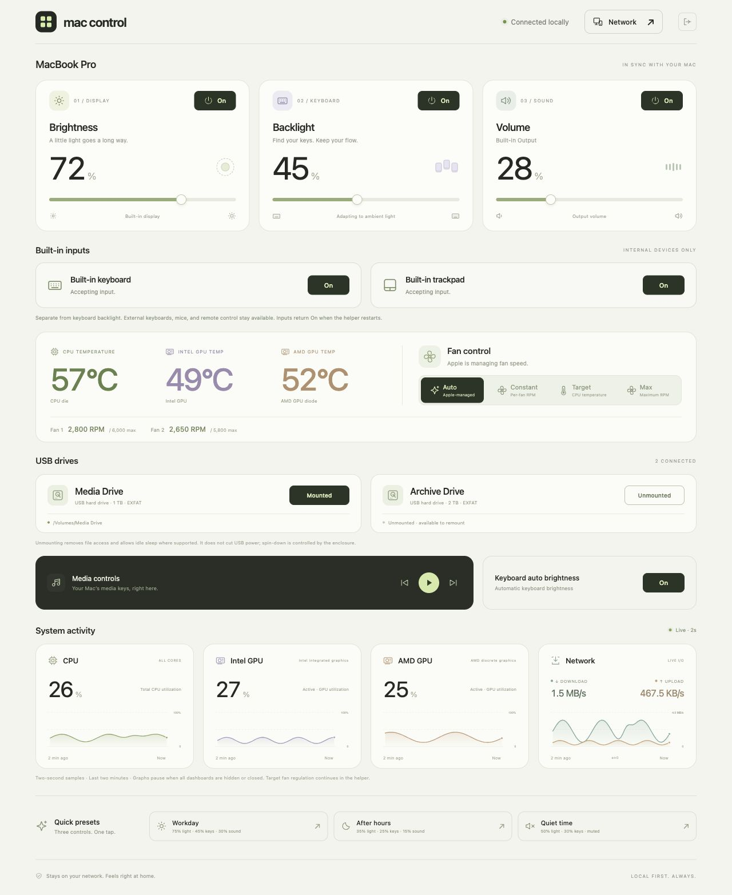
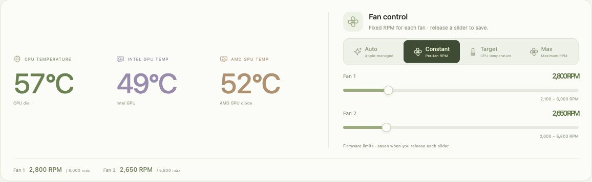
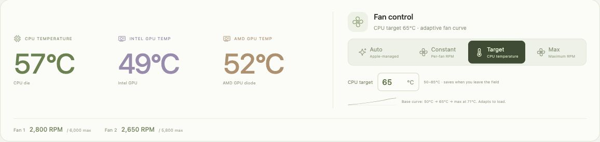
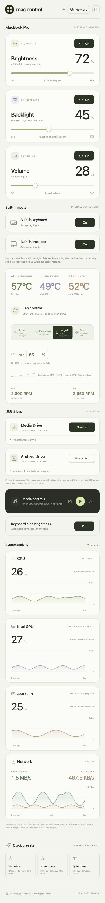

# Mac Control

A self-hosted macOS dashboard for everyday controls, fan management, temperatures, USB drives, and live system activity. Run it directly on the host Mac and open it from another device on the same local network.



*Screenshots show the real frontend with fictional device/drive names and simulated telemetry. They contain no personal hostnames, drive identifiers, or network addresses.*

## What it does

- **Display, keyboard backlight, and sound:** sliders plus On/Off buttons that remember the previous level. Includes keyboard auto brightness, media keys, and quick presets.
- **Built-in keyboard and trackpad:** separate input switches. External keyboards, mice, and remote input remain available. Both internal inputs start **On** after a Mac reboot or input-helper restart.
- **Fans and temperatures:** prominent CPU, Intel GPU, and AMD GPU readings with four cooling modes.
- **USB storage:** connected, formatted external USB drives appear dynamically. Each has a Mounted/Unmounted button; disconnected drives remain identified. Detection refreshes about every ten seconds while the page is visible.
- **Live graphs:** CPU utilization, separate Intel/AMD GPU activity, and upload/download rates with two minutes of history.
- **Persistent background service:** starts at user login, recovers after a crash, and continues when the browser, Terminal, or VNC disconnects.
- **Local password:** choose your own password on installation; Remember this device keeps a session for 30 days. There is no default password.

## Install with one command

Requirements:

- macOS **13 or later** and Apple Command Line Tools.
- A normal Mac login with administrator access for installing the two privileged helpers.
- Supported hardware. Native fan/input interfaces have been verified on an **Intel MacBook Pro**; support on other Macs depends on the interfaces they expose.

Clone this repository, open Terminal in its folder, and run:

```sh
./install.command
```

The installer:

1. Builds and checks every native helper before changing running services.
2. Prompts for a dashboard password only on first setup.
3. Installs or updates the fan and input helpers, requesting administrator authentication when needed.
4. Deploys the dashboard and enables its persistent launchd service.
5. Guides the required macOS privacy approvals and opens the dashboard.

Run it as your **normal user**, without putting `sudo` before the command. The installer requests elevated access only for the privileged helper installation. The web server runs as your user.

If Command Line Tools are missing, the command opens Apple's installer. Finish that installation and run the same command again. No Docker, Homebrew, Node.js, pip packages, or cloud account is required to run the dashboard.

### macOS permissions

The installer opens these settings when needed. Enable the named app, return to Terminal, and press Enter so it can verify access:

| Permission | App | Purpose |
| --- | --- | --- |
| Input Monitoring | **Mac Control Inputs.app** | Disable/re-enable the built-in keyboard and trackpad |
| Accessibility | **Mac Control Media.app** | Send play/pause and previous/next media keys |

If an app is missing from the list, use **+**, then **⌘⇧G**, and select it at the path printed by the installer:

```text
/Library/PrivilegedHelperTools/Mac Control Inputs.app
~/Library/Application Support/Mac Control/.runtime/Mac Control Media.app
```

These approvals require your clicks in macOS. They are not silently granted. The installer restarts the input helper after approval to refresh its permission; both built-in inputs return On.

## Open the dashboard

- **On the host Mac:** <http://localhost:8765>
- **On another local device:** `http://YOUR_MAC_IP:8765`

The **Network** button shows the host's local addresses. Sign in with the dashboard password you chose. The devices need to be able to reach each other on the LAN; guest Wi-Fi isolation, firewall settings, or browser local-network permissions may affect access.

## Fan modes

| Mode | Behavior |
| --- | --- |
| **Auto** | Apple manages fan speed. Default when the fan helper starts. |
| **Constant** | Shows one RPM slider per fan. Saves on release and stays within that fan's firmware minimum/maximum. |
| **Target** | Shows a CPU-temperature field and curve. Accepts 50–85°C; saves when you leave the field or press Enter. |
| **Max** | Sets each fan to its own firmware maximum. |

Auto and Max hide the editable fan fields. Target cooling uses a bounded adaptive curve, ramps up quickly, and backs off gently. An unavailable CPU sensor or failed target write returns management to Apple. The target is a cooling goal; workload and room temperature determine what can be reached.



<details>
<summary>Target mode and mobile layout</summary>





</details>

## USB drive behavior

The list is discovered from macOS Disk Arbitration and I/O Registry metadata. Drive names and IDs are not hardcoded; volume UUIDs identify drives even if macOS changes their disk numbers.

**Unmounting does not cut USB power or guarantee that a hard disk stops spinning.** It removes filesystem access and lets the enclosure idle where supported. The USB device stays registered so it can be remounted remotely. A busy drive returns an error; the app never force-unmounts, formats, or ejects it. Internal disks and protected system mount points are excluded.

macOS may mount a drive again after reboot or reconnect. Actual power-off requires support from the enclosure or an individually switched USB hub.

## Low-load monitoring and restart behavior

All visible dashboards share one sampler, taking readings every two seconds. Graph sampling pauses when every dashboard is hidden or closed; a lost viewer lease expires within five seconds. Drive and input status refresh only while the page is visible. There are no idle graph-sampling subprocesses when nobody is viewing the dashboard.

**Target mode continues its lightweight CPU-temperature regulation with the page closed.** Auto, Constant, and Max block waiting for commands when idle. Chosen fan modes and input Off states survive a VNC disconnect while their helpers continue running.

After a reboot, the fan helper starts in Apple Auto and both built-in inputs start On. The dashboard starts after the Mac user logs in. Its own sleep-prevention assertions keep the system running independently of VNC; explicit system sleep, shutdown, and lid-close sleep are not overridden.

## Update, start, and stop

Run the installer again to update everything:

```sh
./install.command
```

It preserves your password, remembered sessions, and saved control levels. Unchanged privileged helper payloads and launchd configurations are kept without an unnecessary reinstall. `update-controls.command` is an alias for the full installer.

```sh
./install.command --check     # Build/check helpers without changing passwords or services
./install.command --no-open   # Install and report outstanding privacy permissions
python3 service.py status
python3 service.py stop
python3 service.py start
python3 service.py uninstall  # Remove dashboard automatic startup; retain saved data
python3 password.py           # Change the password locally and revoke remembered sessions
```

`enable-inputs.command` restores both built-in inputs. `restart-input-helper.command` restarts their helper without another administrator prompt. The individual fan/input installers and uninstallers are also included for maintenance; `service.py uninstall` does not remove those separate privileged helpers.

## Local data and access

The deployed app is stored in `~/Library/Application Support/Mac Control`. Password hashes, hashed session tokens, saved levels, remembered drive metadata, logs, and compiled helpers live in its private `.runtime/` directory. Runtime data, local environment files, and compiled helpers are excluded from Git. No actual device credentials or default password are included in this repository.

The service listens on IPv4 port **8765**, accepts local/private network clients at known host addresses, checks request origins, requires authentication for controls, and uses revocable HttpOnly/SameSite cookies. It exposes fixed hardware operations rather than an arbitrary shell or SMC-write endpoint. The privileged helpers use private Unix sockets restricted to the installing user and root.

The dashboard uses **HTTP for a trusted intranet**. Do not expose or port-forward it to the internet. For a temporary loopback-only server, use:

```sh
python3 server.py --host 127.0.0.1
```

## Implementation and checks

The server uses Python's standard library. Native Objective-C helpers use Foundation, AppKit, IOKit/AppleSMC, CoreAudio, ApplicationServices, and Disk Arbitration. The frontend is plain HTML, CSS, JavaScript, and SVG; no external assets or CDN are required.

```sh
python3 -m unittest test_auth.py test_controls_metrics.py test_visibility_fans.py test_drives_target.py test_inputs.py test_installer.py
```

The 64 checks cover authentication, preserved credentials, safe installer ordering, hardware-state handling, fan bounds, separate input commands, dynamic drive metadata, and viewer-driven monitoring. Run native build preflight with `./install.command --check`. Some hardware APIs are private and may change after a macOS update; unsupported controls report their unavailable state.

See [implementation and maintenance details](docs/REFERENCE.md) and [third-party notices](THIRD_PARTY_NOTICES.md).
