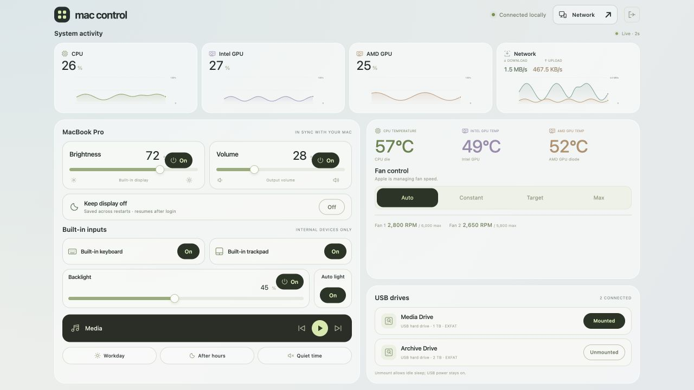
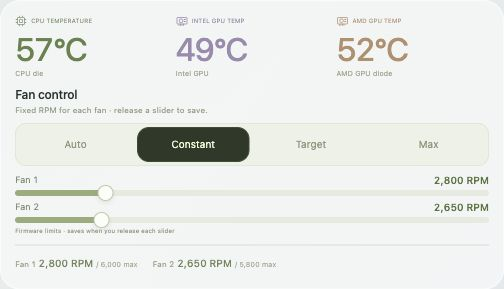
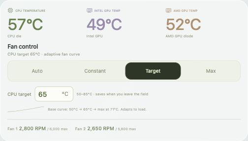
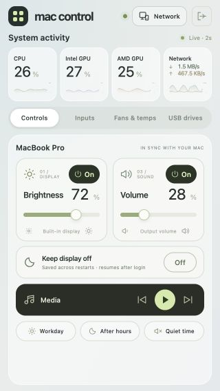
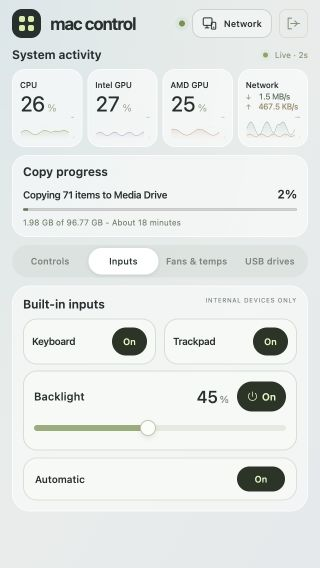
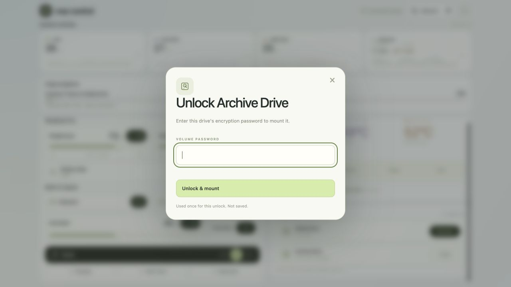

# Mac Control

I wanted to keep my Mac offsite as a dev box keeping MacOS light and managing only through GUI. This enables remote management of the keyboard commands (screen brightness, keyboard brightness, etc.) as well as USB management and disabling built-in controls. A self-hosted macOS dashboard for everyday controls, fan management, temperatures, USB drives, and live system activity. Run it directly on the host Mac and open it from another device on the same local network or over tailscale.



*Screenshots show the real frontend with fictional device/drive names and simulated telemetry. They contain no personal hostnames, drive identifiers, or network addresses.*

## What it does

- **Display, keyboard backlight, and sound:** sliders plus On/Off buttons that remember the previous level. Selected levels, Off/mute states, and keyboard auto brightness restore at startup. Display Off also persists through browser/VNC disconnects until turned On again. Includes keyboard auto brightness, media keys, and quick presets.
- **Built-in keyboard and trackpad:** separate input switches. External keyboards, mice, and remote input remain available. Both internal inputs start **On** after a Mac reboot or input-helper restart.
- **Fans and temperatures:** prominent CPU, Intel GPU, and AMD GPU readings with four cooling modes.
- **USB storage:** connected, formatted external USB drives appear dynamically. Each has a Mounted/Unmounted button; disconnected drives remain identified. Detection refreshes about every ten seconds while the page is visible.
- **Live graphs:** CPU utilization, separate Intel/AMD GPU activity, and upload/download rates with two minutes of history. Hover or tap a chart to inspect its sample time and value. Use the expand icon for a larger live chart with current, average, and peak readings.
- **Persistent background service:** starts at user login, recovers after a crash, and continues when the browser, Terminal, or VNC disconnects.
- **Local password:** choose your own password on installation; Remember this device keeps a session for 30 days. There is no default password.

## Install with one command

Requirements:

- macOS **13 or later** and Apple Command Line Tools.
- A normal Mac login with administrator access for installing the fan, input, and graphics helpers.
- Supported hardware. Native fan/input interfaces have been verified on an **Intel MacBook Pro**; support on other Macs depends on the interfaces they expose.

Clone this repository, open Terminal in its folder, and run:

```sh
./install.command
```

The installer:

1. Builds and checks every native helper before changing running services.
2. Prompts for a dashboard password only on first setup.
3. Installs or updates the fan, input, and graphics helpers, requesting administrator authentication when needed.
4. Deploys the dashboard and enables its persistent launchd service.
5. Guides the required macOS privacy approvals and opens the dashboard.

Run it as your **normal user**, without putting `sudo` before the command. The installer requests elevated access only for the privileged helper installation. The web server runs as your user.

If Command Line Tools are missing, the command opens Apple's installer. Finish that installation and run the same command again. No Docker, Homebrew, Node.js, pip packages, or cloud account is required to run the dashboard.

### macOS permissions

The installer opens these settings when needed. Enable the named app, return to Terminal, and press Enter so it can verify access:

| Permission | App | Purpose |
| --- | --- | --- |
| Input Monitoring | **Mac Control Inputs.app** | Disable/re-enable the built-in keyboard and trackpad |
| Accessibility | **Mac Control Media.app** | Send play/pause and previous/next media keys |
| Full Disk Access (or Files and Folders > Removable Volumes) | **Python** (Command Line Tools `Python.app`) | Unlock encrypted USB drives from the dashboard |

If an app is missing from the list, use **+**, then **⌘⇧G**, and select it at the path printed by the installer:

```text
/Library/PrivilegedHelperTools/Mac Control Inputs.app
/Library/Developer/CommandLineTools/Library/Frameworks/Python3.framework/Versions/3.9/Resources/Python.app
~/Library/Application Support/Mac Control/.runtime/Mac Control Media.app
```

These approvals require your clicks in macOS. They are not silently granted. The installer restarts the input helper after approval to refresh its permission; both built-in inputs return On.

## Open the dashboard

- **On the host Mac:** <http://localhost:8765>
- **On another local device:** `http://YOUR_MAC_IP:8765`

**Tailscale HTTPS:** on mbp15, open [Mac Control over Tailscale](https://mbp15.tail19753.ts.net/mc).
Your device must be on the tailnet; sign in with the existing dashboard password.
Tailscale Serve routes `/mc` to the existing dashboard on port 8765. The existing
root and `/tmb` services are preserved. This uses private Serve, with no Funnel.

To configure another host, save `.runtime/tailscale-serve.json` (mode 0600) with
its exact origin and mount path, for example:

```json
{"origin":"https://YOUR_MAC.YOUR_TAILNET.ts.net","path_prefix":"/mc"}
```

Use the actual lowercase hostname in place of the placeholders. Restart only
the dashboard, then run `tailscale serve --bg --https=443 --set-path=/mc http://127.0.0.1:8765`.
The HTTPS cookie is scoped to `/mc/` and marked Secure; local/LAN access keeps
working at its existing address. First-time password setup must still happen
on the host Mac at localhost. To remove only this route, run
`tailscale serve --https=443 --set-path=/mc off`. Do not reset the other Serve routes.

The **Network** button shows the host's local addresses. Sign in with the dashboard password you chose. The devices need to be able to reach each other on the LAN; guest Wi-Fi isolation, firewall settings, or browser local-network permissions may affect access.

## Dashboard layout

Live CPU, Intel GPU, AMD GPU, RAM, and network graphs sit above power and energy. The dashboard uses a 16px body size, 14px secondary text and chart labels, larger headings and readings, and controls at least 44px tall. Charts draw at their displayed dimensions so labels remain readable at normal zoom. The dashboard fills the available width, uses content-sized cards, and keeps the desktop panels side by side down to laptop widths. Cards reflow into fewer columns on smaller screens. Main content scrolls below the header without a visible scroll track; wheel, touch, and keyboard scrolling remain available. Desktop shows controls, cooling, and drives together; mobile uses Controls, Inputs, Fans & temps, and USB drives tabs. Keyboard backlight and automatic brightness live inside Built-in Inputs. Hidden/closed pages still stop CPU/GPU/network graph sampling.

**Host status:** a compact strip above System activity shows the Mac’s battery gauge, percentage, AC/battery source and charging state, plus Tailscale connection status. Low battery uses an amber gauge. Readings refresh every ten seconds while visible and signed in. Tailscale uses the installed CLI; missing, disconnected, sign-in/approval and unavailable states are shown explicitly. These are read-only indicators for the host Mac.

**Claude usage:** a pill beside the Auto / Intel / AMD graphics toggle shows the Claude plan's 5-hour, weekly and Fable weekly usage, with amber at 80% and red at 100%. Hover it for reset times (Manila) and when the numbers were last updated. Claude Code supplies all of them: Mac Control never reads Claude credentials or calls Anthropic itself. There are two sources:

- **Usage check (automatic, includes Fable):** while the dashboard is viewed, Mac Control asks the installed Claude Code CLI for its `/usage` data at most every five minutes. Claude Code signs in with its own credentials. No prompt is sent, no model request is made and no session is saved. This needs Claude Code installed and signed in on the host Mac; failures are logged once to `.runtime/server.log`.
- **Status line (instant, optional):** to also update after every Claude Code reply, add this to `~/.claude/settings.json` on the host Mac (or merge it into an existing `statusLine` command):

```json
"statusLine": {
  "type": "command",
  "command": "/usr/bin/python3 /path/to/mac-control/claude_usage.py"
}
```

Both sources save only usage percentages and reset times to the private `.runtime/claude-usage.json`; spend, credit and account details are discarded. The status line also prints the summary (`5h 23% · 7d 41% · Fable 3%`) in Claude Code. The usage check includes claude.ai usage; between checks the status line updates the 5-hour and weekly values. Readings older than 30 minutes are dimmed. A window whose reset time has passed shows `—`, and Fable is hidden, until the next update. Usage limits appear for Claude.ai subscription plans (including Team); API-key users see no readings. Until the first update, the pill shows **Set up**.

**Codex usage:** a matching pill beside Claude shows the Codex plan's 5-hour
and weekly percentages used, with the same amber/red thresholds and Manila
reset-time tooltip. The labels follow the actual window durations reported by
Codex. While the dashboard is viewed, a shared background check asks the installed
Codex CLI for account limits at most every five minutes. Codex must be signed in
with ChatGPT on the host Mac; no prompt, conversation or model call is made.
Mac Control does not read Codex credentials. Only quota windows are kept in
memory, so a restart briefly shows **Checking…**. Missing CLI shows **Set up**;
a failed initial read shows **Unavailable**. Later failures retain the last
successful reading, dimmed after 30 minutes; expired windows show `—`. Hover for
when the reading was updated. CLI discovery supports `PATH`, the Codex/ChatGPT
app bundles, `~/.local/bin`, `/opt/homebrew/bin` and `/usr/local/bin`.

The 5-hour windows show a live `Resets in H:MM:SS` countdown below the percentage, using the reported reset timestamp. It updates locally once per second while visible and signed in, with no extra requests. Missing or expired windows have no timer; at zero the old percentage clears to `—` until fresh usage arrives.

Chart tooltips show exact recorded samples in Manila time, with percentage, transfer-rate, watts or energy units. Missing samples stay gaps. Hover with a mouse, tap on a phone, or focus a chart and use Left/Right, Home/End and Escape. Both overview and expanded charts support inspection, including the daily energy log. Mobile section buttons stay pinned while browsing controls; switching sections preserves their position.

## Dashboard guide and raw-data API

Click **?** beside **Connected locally** for the design/UI guide and API
reference, including every graph, toggle, unit and action. It supports mouse,
touch and keyboard, and remains available on mobile. Repository copies:
[UI guide](docs/UI.md), [API reference](docs/API.md),
[OpenAPI](packages/contracts/mac-control.openapi.json) and
[UI map](packages/contracts/dashboard-ui.json).

All dashboard hardware controls and presets can be read/applied through the
JSON API; graph data and indicators are read-only observations. Use
`/api/stats/history` for passive sample history, `/api/stats?viewer=...` for live
sampling, and `/api/power/samples?hours=24` for unbucketed recorded power.
`/api/fans`, `/api/graphics` and `/api/presets` provide direct reads; POST to the
same paths for documented actions. The browser uses the same preset catalog
and action endpoint. Live guides/contracts are at `/api/docs`, `/api/ui` and
`/api/openapi.json` after signing in. Private Tailscale access preserves `/mc`.
Existing password, session and origin checks apply.

## Persistent Display Off

**Graphics mode:** the header’s **Auto / Intel / AMD** selector reads the current macOS graphics policy. The dedicated GPU helper needs one administrator installation with `install-graphics-helper.command` (also included in `install.command`). After that, switching never prompts, including from another device. Auto enables automatic switching, Intel requests integrated graphics, and AMD requests discrete graphics. The setting applies on battery and AC power and is persisted by macOS. External displays require the discrete GPU. The selector confirms the saved policy, rather than which GPU each application is rendering with. Temporary status-read failures leave all three actions available, including Auto for recovery. The root-owned helper accepts only status and these three fixed modes over a private socket restricted to the installing user and root; it never runs browser-provided shell commands. Installing or restarting it preserves the current GPU policy and does not restart the fan/input helpers. `uninstall-graphics-helper.command` removes it while keeping the current policy.

**Display sleep** provides explicit **Sleep** and **Wake** actions and saves the resulting choice. It is a separate saved control that requests actual display sleep while the Mac and dashboard keep running. It restores its On or Off choice after service restart and after a reboot followed by user login, with no page open. While enabled, a tiny display-only helper reapplies sleep if another app or remote session wakes the display. Turning it Off releases that helper, wakes the display, and restores the previous positive brightness. A nonzero brightness command or preset also wakes the display and clears the saved sleep choice. macOS display sleep can affect attached displays as well. It does not apply at the FileVault or login screen before the user session starts. No administrator helper update is needed.

Setting display brightness to **0%** or pressing its **Off** button saves a separate Off setting. A lightweight normal-user helper keeps only the built-in display at zero, even if macOS restores a small nonzero brightness after a remote session ends. It responds to display reconfiguration and checks brightness every two seconds; a reset can therefore appear briefly before being corrected.

Press **On**, choose a nonzero brightness, or use a preset to release the guard before the new brightness is applied. On restores the last positive level; an OS/VNC brightness reset while Off does not overwrite that saved level. The saved Off setting resumes after a dashboard-service restart and at the next user login. While Off is selected, external brightness increases (including hardware keys) are intentionally corrected; use the dashboard On control or stop the service to release it.

This helper does not collect CPU/GPU/network data, control external displays, or wake an already sleeping panel. It runs only while persistent Off is selected and exits when the server closes its pipe. It requires no additional administrator or privacy approval. Graph sampling remains paused without viewers.

## Fan modes

| Mode | Behavior |
| --- | --- |
| **Auto** | Apple manages fan speed. Default when the fan helper starts. |
| **Constant** | Shows one RPM slider per fan. Saves on release and stays within that fan's firmware minimum/maximum. |
| **Target** | Shows a CPU-temperature field and curve. Accepts 50–85°C; saves when you leave the field or press Enter. |
| **Max** | Sets each fan to its own firmware maximum. |

Auto and Max hide the editable fan fields. With fan helper version 4, Target cooling learns a thermal model from logged temperature, CPU load, and actual fan response. It forecasts 20 seconds ahead and aims 2–5°C below the target, ramps up quickly, and backs off gently. Learning is checkpointed independently of the raw logs, so automatic cleanup of records older than 24 hours preserves it across restarts. Older helpers show an update link for predictive Target. An unavailable CPU sensor, missing fan feedback, or failed target write returns management to Apple. The target is a cooling goal; workload and room temperature determine what can be reached.



<details>
<summary>Target mode and mobile layout</summary>






</details>

## USB drive behavior

Locked **encrypted APFS** volumes show **Unlock**. Enter the volume password in the dashboard prompt; a wrong password keeps the prompt open with a retry message. The password goes through stdin to macOS diskutil, never command-line arguments, settings, or logs, and the form clears it after submission or cancellation. Saved mount choices do not save encryption passwords: a drive that locks after reboot/reconnect needs its password again. Other encrypted formats must be unlocked in Disk Utility first.

Unlocking needs the dashboard's Python to have Full Disk Access or Removable Volumes access (see [macOS permissions](#macos-permissions)). The background service cannot show the macOS consent prompt, so without it `diskutil` fails with error -69464 ("restricted by sandbox") and the prompt reports that privacy settings blocked the unlock, even though the same password works in Terminal. The launch agent therefore runs `Python.app` directly, rather than through `caffeinate` or the `/usr/bin/python3` shim, so that macOS checks the grant against Python; the server starts its own `caffeinate -is -w <pid>` to keep the Mac awake. After changing the launch configuration, run `python3 service.py update --in-place`. Failed unlocks log diskutil's message (never the password) to `.runtime/server.log`.


The list is discovered from macOS Disk Arbitration and I/O Registry metadata. Drive names and IDs are not hardcoded; volume UUIDs identify drives even if macOS changes their disk numbers. Only currently connected user drives are shown, including connected drives that are unmounted. Disconnected history and EFI system partitions do not become dashboard cards.

**Unmounting does not cut USB power or guarantee that a hard disk stops spinning.** It removes filesystem access and lets the enclosure idle where supported. The USB device stays registered so it can be remounted remotely. A busy drive returns an error; the app never force-unmounts, formats, or ejects it. Internal disks and protected system mount points are excluded.

Mount/unmount choices are saved by volume UUID and reapplied to connected drives when the dashboard starts after login. Startup retries briefly allow time for disks to appear; busy volumes are never forced. macOS may mount a drive again on a later USB reconnect. Actual power-off requires support from the enclosure or an individually switched USB hub.

<details>
<summary>Encrypted drive unlock prompt</summary>



</details>

## Power and energy

Power & energy shows the current whole-Mac draw in watts, a selectable 1h/12h/24h power graph, and cumulative energy in Wh/kWh since 12:00am **Asia/Manila**. Each power card expands into the same animated, live detail view as the activity charts. Power history ranges can be changed inside the expanded view. The Daily log opens a 90-day line chart with logged-total and coverage summaries. Daily values, recorded time, and average draw remain available in an expandable table. Missing days are gaps; today is an open point because its total is still increasing. This is the Mac's internal SMC System Total sensor, so it excludes charger losses and is not a wall-outlet measurement.

Logging starts with this update; earlier usage cannot be recovered. The service samples every ten seconds without requiring an open dashboard, keeps 24 hours of detailed readings and up to 90 calendar days of daily totals in private `.runtime/power.sqlite3`, and preserves them across restarts. Energy uses trapezoidal integration over valid intervals, split at Manila midnight. Sleep, unavailable sensors, and service downtime leave gaps; totals include only recorded periods. The daily table shows recorded time so partial days are clear.

## Low-load monitoring and restart behavior

All visible dashboards share one sampler, taking readings every two seconds. Graph sampling pauses when every dashboard is hidden or closed; a lost viewer lease expires within five seconds. Drive and input status refresh only while the page is visible. CPU/GPU/network sampling stops when nobody is viewing the dashboard. A separate power logger reads only the SMC system-total power sensor every ten seconds, including with the dashboard closed.

**Target mode continues its lightweight CPU-temperature regulation with the page closed.** Auto, Constant, and Max wait for commands when idle, waking once per minute for log retention without sampling hardware. Chosen fan modes and input Off states survive a VNC disconnect while their helpers continue running.

Settings are saved in private runtime files and restored automatically after a service restart or Mac reboot followed by user login: display brightness (including Off), keyboard backlight and its automatic mode, volume/mute, selected fan mode with its Target temperature or Constant RPMs, and connected USB mount choices. The fan helper initially starts in Apple Auto; the dashboard reapplies the saved selection after login. Both built-in inputs always start On after a Mac/helper restart, as intended. Passwords and remembered sign-ins are retained. Updates preserve the deployed settings.

Startup restoration runs independently of browser viewers, retries unavailable controls/helpers for about a minute, and stops once complete. It does not start graph sampling. The dashboard starts **after the Mac user logs in**, so it cannot apply settings at the FileVault or login screen. Its own sleep-prevention assertions keep the system running independently of VNC; explicit system sleep, shutdown, and lid-close sleep are not overridden.

## Update, start, and stop

Run the installer again to update everything:

```sh
./install.command
```

It preserves your password, remembered sessions, and saved control levels. Unchanged privileged helper payloads and launchd configurations are kept without an unnecessary reinstall. `update-controls.command` is an alias for the full installer.

```sh
./install.command --check     # Build/check helpers without changing passwords or services
./install.command --no-open   # Install and report outstanding privacy permissions
python3 service.py status
python3 service.py stop
python3 service.py start
python3 service.py restart    # Restart only the dashboard; keep privileged helpers running
python3 service.py uninstall  # Remove dashboard automatic startup; retain saved data
python3 password.py           # Change the password locally and revoke remembered sessions
```

`enable-inputs.command` restores both built-in inputs. `restart-input-helper.command` restarts their helper without another administrator prompt. The individual fan/input installers and uninstallers are also included for maintenance; `service.py uninstall` does not remove those separate privileged helpers.

### Run directly from a checkout

An existing service can also be migrated to run directly from its repository,
with saved state and logs in the checkout's gitignored `.runtime/` directory.
`python3 service.py status` reports the active source and runtime paths. After
migration, start/stop/restart, password changes, and `./install.command` all follow
the installed checkout; updates do not redeploy it to Application Support.
Python changes need `python3 service.py restart`; native changes use the installer.
The checkout must stay at its installed path for automatic startup to work.

For a **new installation only**, `python3 service.py install --in-place` registers
this checkout after its helpers and password have been prepared. It refuses to
relocate an existing service without a state migration. A migration requires a
private backup, native preflight, a brief dashboard restart, and preservation of
the existing `.runtime/` files and macOS permission-approved helper paths. The
fan/input daemons remain installed in their standard system locations.

## Local data and access

By default, the deployed app is stored in `~/Library/Application Support/Mac Control`; a checkout installation uses the repository itself. Password hashes, hashed session tokens, saved levels, remembered drive metadata, logs, and compiled helpers live in the active installation's private `.runtime/` directory. Runtime data, local migration backups (`.local-backups/`), local environment files, and compiled helpers are excluded from Git. No actual device credentials or default password are included in this repository.

The service listens on IPv4 port **8765**, accepts local/private network clients at known host addresses, checks request origins, requires authentication for controls, and uses revocable HttpOnly/SameSite cookies. It exposes fixed hardware operations rather than an arbitrary shell or SMC-write endpoint. The privileged helpers use private Unix sockets restricted to the installing user and root.

The dashboard uses **HTTP for a trusted intranet**. Do not expose or port-forward it to the internet. For a temporary loopback-only server, use:

```sh
python3 server.py --host 127.0.0.1
```

Encrypted-drive mounting distinguishes an actual locked volume from an unlocked volume that could not mount. The latter retries Mount without asking for the password again; permission and mount errors are kept separate from authentication failures. An Unlock action always requests mounting, including drives with a mix of mounted and locked volumes. Passwords are still used once and never saved.

## API documentation

Read the [HTTP API guide](docs/API.md) for authentication, request rules, all 21
current operations, errors and a client example. Machine consumers can start with
the [API/use-case manifest](packages/contracts/mac-control-api.json) and the full
[Mac Control OpenAPI](packages/contracts/mac-control.openapi.json). The
[contract index](packages/contracts/README.md) distinguishes these local contracts
from the separate Notifier API bundle.

## Finder copy progress through DevBox Notifier

Our first API integration use case was copy progress from the separate DevBox
Notifier service. The browser
polls this server's session-protected `GET /api/file-activity`; this server then
pulls `GET /v1/snapshot` from loopback port 8876 with a locally held credential.
The notifier does not push into Mac Control. Existing controls continue to work
when the notifier is unavailable, and its administrator token never reaches the
browser. Finder progress requires the separate observer app's Accessibility
permission; no duplicate Mac progress window is opened.
Each active copy shows its name, overall percentage, transferred bytes/time remaining, and a current filename when available. Empty file sections and Finder navigation/sidebar entries are hidden. Completed jobs and synthetic tests are excluded.

Read the [integration guide](docs/integrations/mac-control.md) for configuration,
request direction, polling, authentication, exposed endpoints and limitations.
Machine consumers can read the [versioned integration manifest](packages/contracts/mac-control-integration.json),
[JSON Schema](packages/contracts/mac-control-activity.schema.json),
[bridge OpenAPI](packages/contracts/mac-control-bridge.openapi.json),
[notifier OpenAPI](packages/contracts/openapi.json) and
[fictional examples](packages/contracts/mac-control-examples.json).
These are committed copies of the notifier's canonical contract bundle. The
optional notifier has its own Python environment and setup; installing Mac Control
does not install it or enable iPhone push provisioning.

## Implementation and checks

The server uses Python's standard library. Native Objective-C helpers use Foundation, AppKit, IOKit/AppleSMC, CoreAudio, ApplicationServices, and Disk Arbitration. The frontend is plain HTML, CSS, JavaScript, and SVG; no external assets or CDN are required.

```sh
python3 -m unittest discover
```

The checks cover authentication, preserved credentials, safe installer ordering, installed service paths, hardware-state handling, fan bounds, separate input commands, dynamic drive metadata, persistent Display Off, guard recovery, persistent display sleep and wake ordering, restoration over simulated boot defaults, bounded startup retries, viewer-driven monitoring, and notifier bridge authentication/fallback behavior. Run native build preflight with `./install.command --check`. Some hardware APIs are private and may change after a macOS update; unsupported controls report their unavailable state.

See [implementation and maintenance details](docs/REFERENCE.md) and [third-party notices](THIRD_PARTY_NOTICES.md).

Human and AI contributors should start with [AGENTS.md](AGENTS.md) and the shared,
provider-neutral memory: [MEMORY.md](MEMORY.md) for people and
[MEMORY.json](MEMORY.json) for machine consumers. Keep both memory formats current
together when project knowledge, decisions, preferences, or operations change.

Copy progress shows only active copy names, overall percentage, transferred bytes/time remaining, and a current filename when available. Finder navigation/sidebar entries and empty per-file placeholders are hidden. Slider titles, percentages, and On/Off buttons use separate layout cells at every card width.

Copy rows require transferred-byte or time-remaining details. Generic Finder operation records, stale registry entries, and percentage-only observations are hidden; detailed Finder summaries take precedence over their registry duplicates. Frontend regression checks execute the actual selector with macOS JavaScriptCore.
