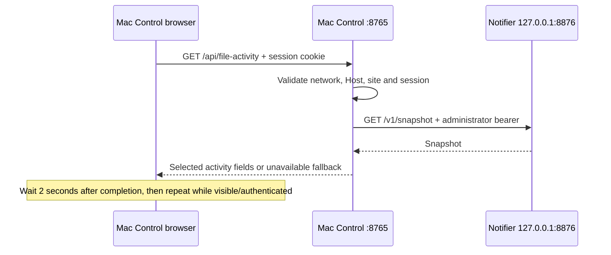

# Mac Control HTTP API

Documentation revision **1.5.0**, reviewed against this checkout on **2026-11-04**.
This revision versions the documentation, not a version negotiated by the server.
The routes currently use `/api/` without an API version prefix.

The API serves the dashboard's controls, telemetry and optional integrations.
Python's `ThreadingHTTPServer` in [server.py](../server.py) dispatches requests to
the authentication store, control managers, native helpers and Notifier bridge.
The default origin is `http://localhost:8765`; `--port` can change the port and
`--host` selects `0.0.0.0` (default) or `127.0.0.1`.

Machine consumers should start with
[mac-control-api.json](../packages/contracts/mac-control-api.json) and the complete
[Mac Control OpenAPI](../packages/contracts/mac-control.openapi.json).
[openapi.json](../packages/contracts/openapi.json) describes the separate
**Notifier API**, whose routes start with `/v1/`.

All dashboard graphs and indicators have JSON read endpoints, and all hardware
controls and presets have JSON action endpoints. Values are numeric data and
metadata; observed telemetry and historical totals are read-only. See the
[design and UI guide](UI.md) for every element's purpose, fields, units and API
mapping. The **?** beside **Connected locally** opens both guides. Authenticated
clients can also read `/api/docs`, `/api/ui` and `/api/openapi.json`.

## Request and response rules

Every request, including sign-in and static assets, passes the source and Host
checks. The source IP must satisfy Python's private, loopback or link-local check.
`Host` must contain the configured port and an allowed hostname/address: localhost,
127.0.0.1, the Mac's discovered hostnames or private IPv4 addresses captured at
startup. Arbitrary aliases are not automatically allowed. The explicitly configured Tailscale
Serve HTTPS context below is the only proxy exception.

Requests with `Sec-Fetch-Site: cross-site` are rejected. Every POST must also send
`Origin: http://HOST:PORT` matching its Host header exactly, including sign-in and
logout. A non-browser client must explicitly send this Origin. GET does not
require Origin. The server does not implement CORS preflights or cross-origin
access.

Optional Tailscale Serve configuration lives in `.runtime/tailscale-serve.json`:
`{"origin":"https://HOST.TAILNET.ts.net","path_prefix":"/mc"}` using the actual
lowercase hostname. For this context only, the TCP peer must be loopback,
Host and X-Forwarded-Host must exactly match the configured HTTPS hostname,
and X-Forwarded-Proto must be `https`. Funnel-marked requests are rejected.
POST Origin must exactly equal the configured HTTPS origin. Forwarded headers
outside this context are rejected, including with a legacy localhost Host.
Serve removes the `/mc` prefix before proxying, so clients use
`https://HOST.TAILNET.ts.net/mc/api/...` while backend paths remain `/api/...`.
The proxy never grants loopback-only setup or helper-path access. No endpoint
bypasses dashboard session authentication.

POST bodies must be JSON objects with `Content-Type: application/json` (an optional
charset is accepted), and `Content-Length` from 1 through 4096 bytes. Even logout
needs a body, such as `{}`. Unknown fields are generally ignored; clients should
send only documented fields. GET query strings are used only where listed below.

Handled API responses are JSON with `Cache-Control: no-store`. Responses also set
`X-Content-Type-Options: nosniff`, `X-Frame-Options: DENY`, `Referrer-Policy:
no-referrer` and a same-origin Content Security Policy. There is no pagination,
webhook registration or WebSocket endpoint on Mac Control. Methods other than
GET/POST use the standard HTTP handler's unsupported-method response (normally
501 HTML); do not assume every protocol error is JSON.

## Authentication lifecycle

1. Read `GET /api/session`. This returns `authenticated`, `setupRequired` and
   `canSetup` (whether the connection is direct loopback, excluding Serve), without requiring a session.
2. If setup is required, `POST /api/setup` from the host Mac over loopback with
   `{"password":"PASSWORD_PLACEHOLDER","remember":false}`. Setup only creates the
   first password; it cannot replace an existing one.
3. Otherwise sign in with `POST /api/session` using the same body. Passwords must
   contain 1–1024 characters. `remember` is an optional boolean, default false.
4. Keep the returned `mac_control` cookie for private routes. Both setup and login
   return `{"authenticated":true,"remembered":false}` (or true) and `Set-Cookie`.
5. `POST /api/logout` with `{}` revokes the current session and clears its cookie.

Cookies for direct access are `HttpOnly; SameSite=Strict; Path=/`. The configured
Serve context uses `HttpOnly; SameSite=Strict; Path=/mc/; Secure` (with the
configured prefix), including the same scope when clearing a cookie. A normal session has a 24-hour
server expiry and a browser-session cookie. A remembered session has a 30-day
server expiry and `Max-Age=2592000`. Expiry is fixed at creation, not renewed by
reads. Restarts preserve stored sessions; password changes revoke them all. The
database stores password hashes and session-token hashes, not plaintext values.
Mac Control has no bearer token, role model or scoped service-account API.

Sign-in tracks failed password attempts per source IP in process memory for a
rolling minute. After eight failures, authentication/setup requests reaching that
check return 429 until the window clears. Successful authentication clears the
source's attempts. Setup is also subject to this check. Serve clients share
the proxy's loopback rate-limit bucket.

## Endpoint inventory

All rows require a valid session except GET/POST session, setup, and stats/leave.
Those exceptions still require the network/Host/site checks and POST Origin/body
rules. Read routes can still refresh caches or sampling leases.

| Method and path | Input | Result and behavior |
| --- | --- | --- |
| `GET /api/session` | None | Authentication/setup booleans. |
| `POST /api/setup` | `password`, optional boolean `remember` | Loopback-only first setup; creates a session. 409 if already configured. |
| `POST /api/session` | `password`, optional boolean `remember` | Creates a session; incorrect password returns 401. |
| `POST /api/logout` | `{}` | Revokes the current session; `authenticated=false`. |
| `GET /api/host-status` | None | Host `battery` (`available`, nullable `present`/`percent`, `source`, `state`), `tailscale.state`, `codex` quota windows (`state`, nullable `updatedAt`, `primary`, `secondary`) and `claude` plan usage (`state`, nullable `updatedAt`, `fiveHour`, `sevenDay`, `modelWeekly` list); read-only shared ten-second cache; may start background Claude Code and Codex usage checks. |
| `GET /api/state` | None | Hardware state, `capabilities`, saved `restoreLevels`, display state, `device`, `graphics`. |
| `POST /api/control` | `control`, numeric `value` | Controls: `brightness`, `keyboard`, `volume` accept 0–100; `mute`, `keyboardAuto`, `displaySleep` accept numeric 0/1. JSON booleans are rejected for value. Returns hardware state. |
| `POST /api/toggle` | `control`, boolean `enabled` | `brightness`, `keyboard`, `volume`; Off preserves a restore level, On restores it. Volume Off mutes. Returns hardware state. |
| `POST /api/media` | `action`: `play`, `next`, `previous` | Sends a media key (`play` is play/pause); returns hardware state. |
| `POST /api/graphics` | `mode`: `auto`, `intel`, `amd` | Returns graphics status after helper application and saved-policy confirmation. |
| `POST /api/fans` | `mode`: `auto`, `max`, `target`, `constant` | Returns fan-controller status plus epoch `time`. Target requires finite numeric `temperature` 50–85 °C. Constant requires `speeds`: 1–10 integer RPMs, 500–16383, one per detected fan in reported order and within each fan's firmware limits. |
| `GET /api/inputs` | None | `installed`, `version`, separate `keyboard` and `trackpad` state (`enabled`, `controllable`). |
| `POST /api/inputs` | `device`: `keyboard` or `trackpad`; boolean `enabled` | Sets a built-in input and returns status; partial/unconfirmed results can return 409. |
| `GET /api/drives` | None | `drives` array of currently connected eligible external USB targets; IDs are volume UUIDs. |
| `POST /api/drives` | `id`, boolean `mounted`, optional `password` | Mount/unmount or unlock-and-mount. Password is allowed only when mounting, must be nonempty, at most 1024 UTF-8 bytes, and contain no CR/LF/NUL. A locked target without a password returns 409 with `requiresPassword=true`. |
| `GET /api/stats` | Required query `viewer`: 32 lowercase hex characters | Renews a session-bound viewer lease; returns `history`, `interval`, `window`, `error`, `running`, `viewers`, `samples`, `fanController`, `fanControl`. |
| `GET /api/stats/status` | None | `sampling`, `viewers`, `sensorReads`, `interval`; does not create a viewer lease. |
| `POST /api/stats/leave` | `viewer`: 32 lowercase hex characters | `{"paused":true}`. Does not require a valid session; removes only the lease keyed to the supplied cookie and viewer ID. Does not pause other viewers. |
| `GET /api/power` | Optional query `hours`: `1` (default), `12`, `24` | Current watts, selected history, today's Wh/coverage/history, daily totals and timezone. Invalid windows return 400. |
| `GET /api/connection` | None | Name, hostname, LAN `urls`, `localUrl`, port, `local`, fan installer path; `helperPath` only over loopback. Does not include raw `addresses`. |
| `GET /api/file-activity` | None | First integration: selected Notifier snapshot, or HTTP 200 `available=false` fallback. See below. |
| `GET /api/graphics` | None | Same graphics policy/helper state as `state.graphics`; cache up to two seconds. |
| `GET /api/fans` | None | Fan mode, actual RPM, bounds and target/prediction/learning metadata supported by the helper; cache up to four seconds. Does not lease telemetry sampling. |
| `GET /api/presets` | None | `presets` keyed by `work`, `evening`, `quiet`: name, brightness/keyboard/volume percentages, numeric mute 0/1. Shared catalog used by the browser. |
| `POST /api/presets` | `preset`: `work`, `evening`, `quiet` | Applies supported brightness, keyboard, volume, mute in order; returns `preset`, hardware `state`, `applied` and `skipped` control names. Sequential, not atomic; 409 includes those fields plus `error`. Helper/transport failure can follow partial success; re-read state before retrying. |
| `GET /api/stats/history` | None | Same numeric two-minute history and fan metadata as stats, without creating/renewing a viewer lease. Can be empty when sampling has paused. |
| `GET /api/power/samples` | Optional query `hours`: `1` (default), `12`, `24` | Unbucketed stored observations: `now`, `hours`, `interval`, `timezone`, `error`, `samples`. Each sample has `time`, nullable `watts`, boolean `connected`, accounting `day`, `cumulative_wh`. Retained detail is 24 hours. |
| `GET /api/docs` | None | `guide` and `api` strings containing repository UI and API guides as Markdown. |
| `GET /api/ui` | None | Machine-readable inventory, usage, fields, units, read/action mapping and data semantics. |
| `GET /api/openapi.json` | None | Complete Mac Control OpenAPI. Relative bridge references resolve beside this endpoint. |
| `GET /api/mac-control-bridge.openapi.json` | None | Notifier-exported bridge contract, served to resolve OpenAPI references. |
| `GET /api/mac-control-activity.schema.json` | None | Notifier-exported activity/configuration JSON Schema; documentation only, without private configuration or credentials. |

For drive mounting, `requiresPassword=true` indicates that the target remains
locked. Supplying a password for an already-unlocked volume uses a normal mount
operation; it does not re-run password unlock. Mount failures retain their actual
mount/permission message. Unlock failures distinguish password, permission and
general failures using fixed messages; raw tool diagnostics are not returned.

Hardware/helper payloads vary by capabilities and installed helper versions. The
OpenAPI intentionally allows additional fields rather than pretending to freeze
every native helper's output. Check `capabilities`, `installed`, `available`, null
values and `error` before treating a requested change as confirmed.

Stats uses one shared sampler (default 2 seconds), a 120-second returned history
and a 5-second lease per `(session, viewer)` pair. Generate a distinct viewer ID
for each visible client, renew while visible and send leave when hiding/closing.
Without active leases sampling pauses. Power logging is independent, normally
every 10 seconds even without viewers. Power chart points use `{time,value}`;
missing values preserve gaps. `watts=null` means unavailable, not zero; daily
totals describe observed coverage, not an extrapolated full day. Epoch times are
seconds; power responses carry their accounting timezone.

`/api/stats/history` is passive: it never starts or extends the sampler lease.
Live clients use `/api/stats?viewer=...`, keeping the same random ID and cookie
between requests. History has one point per recorded sample, without chart
interpolation. Fields include `cpu`, `ram`, `intelGpu`, `amdGpu` (percent),
`memory.used/total/compressed` (bytes), `download`/`upload` (bytes/s), temperature
objects with `celsius`, and fans with actual/target/minimum/maximum RPM. GPU
metadata and `fanController` expose hardware/controller state. CPU/network rates
can be null until two consecutive samples exist.

Power `/api/power` graph histories can average time buckets; use
`/api/power/samples` for the recorded values with no averaging. `connected=false`
marks a startup, unavailable reading or continuity boundary; do not integrate
across it. `cumulative_wh` is recorded daily Wh at that point; `day` uses the
returned timezone. Daily totals/coverage remain in `/api/power.daily` for up to
90 days after detailed samples expire. Browser tabs, expansion, cursor, draft
controls and selected chart range are local presentation choices; API clients
build their own views from these values.

Host status reads `pmset -g batt` and an installed Tailscale CLI, with a two-second
timeout per command and no background polling. The browser polls every ten seconds
while visible and signed in. Tailscale is connected only when `BackendState` is
`Running` and `Self.Online` is true. Missing CLI, failed reads, login/approval needs
and disconnected states are distinct; peer, address and account data are omitted.
Battery percentage is null when unavailable; `present=false` means no battery.
These indicators describe the host Mac, independently of the browser connection.

`claude` summarizes Claude plan usage reported by Claude Code. Mac Control reads
only the private `.runtime/claude-usage.json` file, written by `claude_usage.py`
from two sources: Claude Code's status line after each reply, and a background
usage check. While host status is being requested, the server asks the local
Claude Code CLI for its `/usage` data at most every five minutes (30-second
timeout, never concurrent; the experimental `get_usage` control request with no
prompt, no model call and no saved session). Mac Control never reads Claude
credentials or contacts Anthropic itself; Claude Code uses its own sign-in.
`state` is `available`, `not-configured` (nothing has been written yet) or
`unavailable` (unreadable or invalid file). `fiveHour` and `sevenDay` are
`{usedPercent, resetsAt}` (0–100, one decimal; epoch seconds), or null when not
reported or once `resetsAt` has passed. `modelWeekly` lists per-model weekly
windows from the usage check, such as `{name: "Fable", usedPercent, resetsAt}`;
expired entries are omitted. `updatedAt` is the epoch second of the last update.
Values are as of that update, not live. Concurrent reports are merged: within
the same window usage never decreases, and a later window replaces an earlier
one. Spend, credit and account details from Claude Code are discarded.

`codex` summarizes the last successful Codex plan quota read. On host-status
cache refresh, a shared background check runs `codex app-server --listen stdio://`
at most every five minutes (30-second timeout, 1 MiB output cap, never concurrent).
It performs the `initialize` / `initialized` handshake and
`account/rateLimits/read`; no thread or model turn is created. Codex handles its
own ChatGPT sign-in; Mac Control does not read credentials or send direct OpenAI
HTTP requests. Only the `codex` quota bucket is retained, in memory; account,
credit and other bucket details are discarded. `primary` and `secondary` are
`{usedPercent, resetsAt, windowMinutes}` or null if absent, invalid or expired.
Window durations come from Codex rather than an assumed 5-hour/weekly schedule.
`updatedAt` is the epoch second of the successful check; failures retain the last
success with its original timestamp. Before any success, `state` is `checking`,
`not-configured` (CLI missing) or `unavailable` (failed read). Once a reading
exists it is `available`; expired windows remain null until a fresh check.
The cache starts empty after a dashboard restart. No persistent usage file is
written. See the [official app-server protocol](https://learn.chatgpt.com/docs/app-server).

## Errors

| Status | Meaning |
| --- | --- |
| 400 | Invalid JSON/body size/content type, parameter or command. |
| 401 | Invalid/expired/revoked/missing session, or incorrect sign-in password. Private-route failures include `loginRequired=true`. |
| 403 | Network/Host/site/Origin rejection, or non-loopback setup. |
| 404 | Unknown GET path, or unknown POST path after body/session checks. |
| 409 | Setup already configured, or a hardware command returned a state containing an error. Inspect the full state; drives can include `requiresPassword`. |
| 429 | Authentication rate limit. No `Retry-After` header is currently set. |
| 503 | Caught control/helper `RuntimeError`; response contains `error`. |

Typical errors are `{"error":"message"}`; state-bearing errors can contain more
fields. Network checks run first, then POST parsing, then route-specific checks,
so malformed or unauthenticated requests can fail before route lookup. Sensor or
integration unavailability may instead be represented in a **200** payload.
There is no general automatic retry or idempotency-key mechanism. Re-read state
before retrying an uncertain mutation, especially media commands.

## First use case: DevBox Notifier copy progress

The first API integration use case was showing Notifier's Finder/managed-copy
activity in Mac Control. The browser uses its existing Mac Control session;
Mac Control reads the separate service with a private server-held credential.



The private `.runtime/notifier-bridge.json` points to the Notifier state directory
and port; [BridgeConfig](../packages/contracts/mac-control-activity.schema.json)
defines the expected format. The bridge reads `state_dir/admin-token`, fixes the
upstream host to `127.0.0.1`, bypasses environment proxies, times out after 2
seconds and caps the response at 2 MiB. It forwards `transfers`, `file_activity`,
`finder_progress` (or `{}` for older upstreams) and `push`, adding `available=true`.
Host/container telemetry is omitted. It does not validate the full upstream
payload against JSON Schema at runtime.

Configuration/read/HTTP/JSON/missing-field failures caught by the bridge yield:

```json
{"available":false,"reason":"notifier_unavailable","transfers":[],"file_activity":{"items":[]}}
```

This is HTTP 200 after successful Mac Control authorization. Finder/push/observer
fields are absent; check `available` first. It means the activity source is
unavailable, not that no copy is running. A missing session yields 401 and a
cross-site request yields 403 **without contacting Notifier**.

The local browser shows up to eight qualifying active copies with overall
progress, measured detail and the first current filename (plus a count of other
current files). It hides terminal/synthetic jobs, generic filesystem hints,
unmeasured placeholders and Finder navigation. Finder labels must match the
current English operation filter and include measured byte/time detail; localized
labels can therefore be omitted even when the API returns them. Failed requests
or `available=false` hide the copy section. Polling pauses while hidden, signed
out or unloaded; each visible client independently triggers upstream reads.

Finder percentages come from Accessibility observations; current-file details are
estimates from open-file metadata. Window disappearance is not verified
completion. Managed-copy counters have separate worker verification semantics.
The bridge credential is an administrator bearer even though this route only
reads. It never goes to the browser. Notifier's own WebSocket, Web Push and APNs
paths are separate from this polling integration.

See the [detailed integration guide](integrations/mac-control.md) and the
[first-use-case manifest](../packages/contracts/mac-control-api.json). The existing
Notifier contract bundle is version 1.1.0, dated 2026-11-01; this local guide is
based on this checkout's code, not a live check of the separate Notifier service.

## Read-only client example

This standard-library example prompts for the dashboard password without putting
it in shell history, keeps the cookie in memory, reads activity and logs out.
It assumes initial setup has already been completed on the host Mac.

```python
import getpass
import http.cookiejar
import json
import urllib.request

origin = "http://localhost:8765"
client = urllib.request.build_opener(
    urllib.request.ProxyHandler({}),
    urllib.request.HTTPCookieProcessor(http.cookiejar.CookieJar()),
)

def request(path, body=None):
    headers = {}
    data = None
    if body is not None:
        headers = {"Content-Type": "application/json", "Origin": origin}
        data = json.dumps(body).encode()
    req = urllib.request.Request(origin + path, data=data, headers=headers)
    with client.open(req, timeout=10) as response:
        return json.load(response)

request("/api/session", {"password": getpass.getpass(), "remember": False})
try:
    activity = request("/api/file-activity")
    print(activity)
finally:
    request("/api/logout", {})
```

## Action examples

Use the authenticated `request()` helper from the client example above. These
perform real actions when executed; check hardware capability flags first.

```python
state = request('/api/state')
history = request('/api/stats/history')  # no sampling lease
raw_power = request('/api/power/samples?hours=24')
request('/api/control', {'control': 'brightness', 'value': 60})
request('/api/toggle', {'control': 'volume', 'enabled': False})
request('/api/control', {'control': 'keyboardAuto', 'value': 1})
request('/api/control', {'control': 'displaySleep', 'value': 0})
request('/api/graphics', {'mode': 'auto'})
request('/api/fans', {'mode': 'target', 'temperature': 70})
request('/api/presets', {'preset': 'work'})
request('/api/inputs', {'device': 'trackpad', 'enabled': True})
request('/api/media', {'action': 'next'})
# Replace with an eligible ID from GET /api/drives:
request('/api/drives', {'id': 'VOLUME_UUID', 'mounted': True})
```

For constant fans, read `/api/fans` first and provide one integer RPM per returned
fan, in order, within each firmware minimum and maximum. For locked drives, send
the password only when mounting. Indicators and history have no write action.
For live activity generate a random viewer with `uuid.uuid4().hex`, poll
`/api/stats?viewer=ID` about every two seconds, and finish with
`request('/api/stats/leave', {'viewer': ID})` using the same session cookie.

## Maintaining these documents

The implementation is authoritative. When routes, validation, authorization or
response semantics change, update this guide, `mac-control.openapi.json`,
`mac-control-api.json` and both memory files together. Keep the first use case's
code references and behavior current. Notifier owns the existing exported bundle
described in [the contract index](../packages/contracts/README.md); regenerate it
in its source repository rather than overwriting it with the Mac Control API.
The guides are repository artifacts also served by `/api/docs`; the UI map and
OpenAPI bundle use the authenticated routes above. Keep `docs/UI.md` and
`dashboard-ui.json` aligned with UI/endpoint changes. The guide renderer creates
text nodes, headings, lists, tables and code blocks; it executes no Markdown
HTML. Reload the page to refresh an already-open guide cache.
Documentation-only updates need no service or helper restart.
